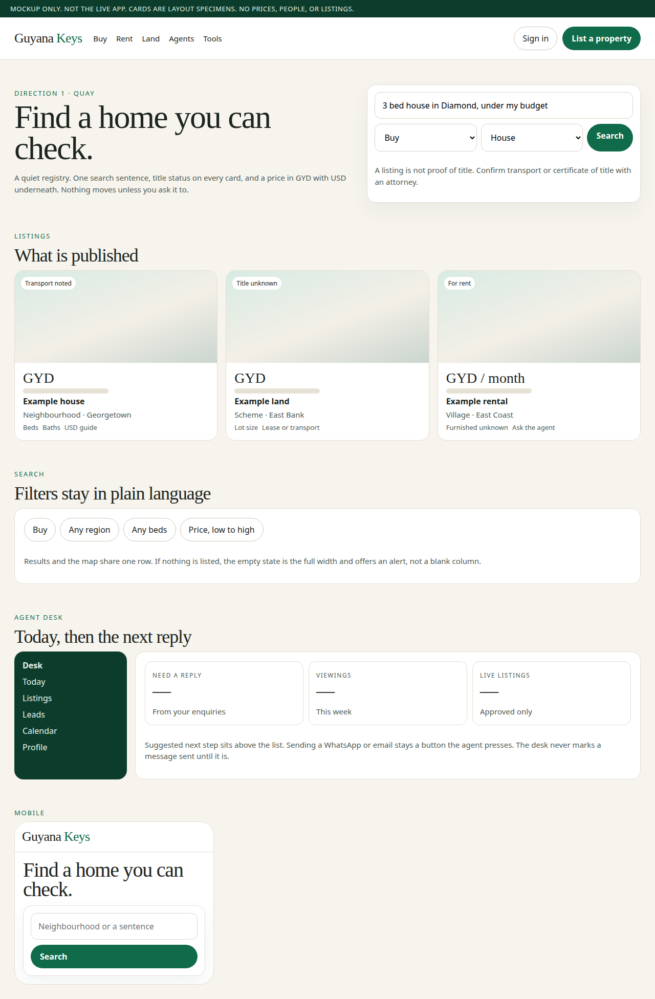
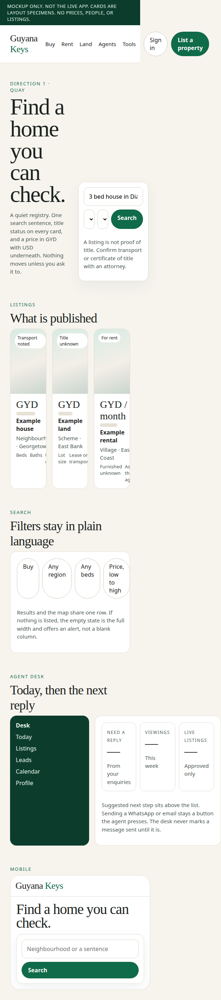
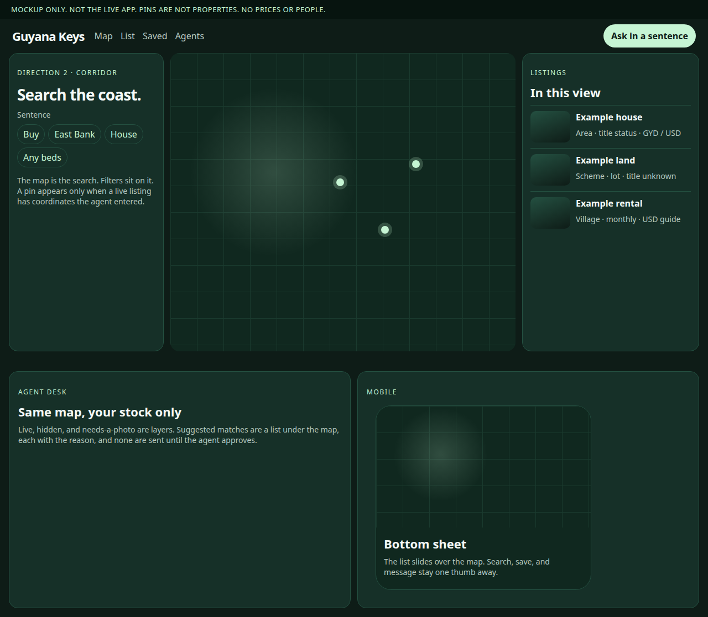
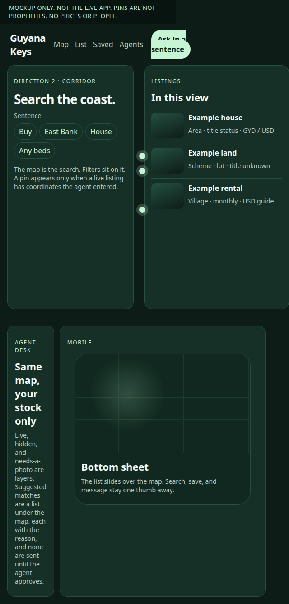
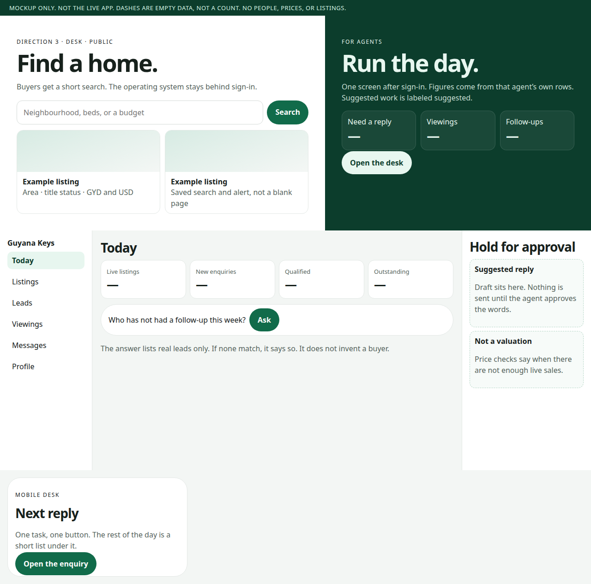
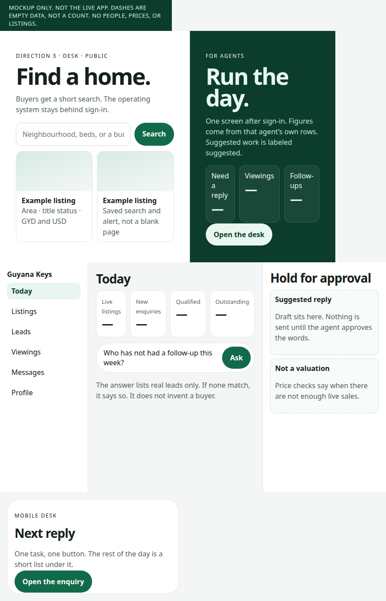

# Guyana Keys strategy review — 22 October 2026

Review and recommendation only. This document does not change the live site, the database, or Vercel. It does not add a paid service. Figures are either from the repository, from a page cited below, or marked as an estimate or unverified.

The public product reviewed is `main` at `cb503c3` (“Keep live alerts working, and lock the preview desk”). Draft pull request [#19](https://github.com/vernxhq-collab/guyana-keys/pull/19) restyles `/tools` and the empty states only. It is not merged, so it is not treated as the live design. Scores below are for the product on `main`.

Mockups are static HTML and PNG files in `mockups/`. They are not listings, prices, agents, or the live app.

## How a claim is marked

- **Seen in the repo.** A file or route is named.
- **Seen on a public page.** A URL and the date of this review (22 October 2026) are given. Marketing lines are quoted as the site’s own words, not as facts we checked.
- **Estimate.** A reasoned range, not a measurement.
- **Unverified.** We did not count it, open the vendor bill, or re-test the claim.

No production database query was run. An empty public page means the rendered catalog was empty in the screenshots from this review. It is not a census of every row an admin might see.

---

## A. Platform audit

| Area | Score | One line |
| --- | --- | --- |
| Design | 4/10 | A recognisable green brand and a usable hero. Cards, tools, and empty pages do not yet feel like a portal people trust with a deposit. |
| UX | 4/10 | Search, filters, and a map exist. The public site still dead-ends when the catalog is empty, and the mobile header wraps into a second row. |
| Functionality | 5/10 | Real listings, enquiries, alerts, a mortgage calculator, title wording, and a map are built. Comparison, tours, buyer scheduling, and a seller dashboard are not. |
| Agent tools | 5/10 | A signed-in desk can list, reply, stage a lead, and book a viewing. The command centre the brief describes is only partly there, and several screens are preview-only. |
| AI capabilities | 2/10 | “Ask Keys” and listing drafts are local rules and sentence templates. There is no model, no briefing over live rows, and no separation of a model suggestion from a completed send beyond “the agent typed it”. |
| Architecture | 7/10 | Next.js, Supabase, server routes, and a preview world that cannot leak into production. The right shape. It does not yet have a workflow engine, and the service role bypasses row security. |
| Security | 6/10 | Row-level security, httpOnly session cookies, rate limits, a locked preview, and an alerts token with no fallback. The server still holds a key that ignores those policies. There is no private vault for title documents. |
| Commercial readiness | 2/10 | Listings are free, which matches the current direction, but there is no checkout, no published offer, and the public Buy / Rent / Land pages render an empty state. A marketplace with nothing on the shelf is not ready to charge. |

### Design — 4/10

What is actually on the page:

- Home (`src/app/page.tsx`) is a full-bleed stock photograph, the line “Find property in Guyana.”, Buy/Rent tabs, a neighbourhood field, and type and beds filters. The hero image is an Unsplash URL, not a Guyana photograph.
- Listing cards (`src/components/ListingCard.tsx`) show one photo, a sale/rent tag, a GYD price, a USD guide, title, area, and beds or baths. There is no gallery on the card, no title-status chip, and a missing photo becomes the grey “No photo yet” SVG in `src/lib/catalog.ts`.
- On 22 October 2026 the public Rent tab rendered “New listings coming soon” in a narrow card with empty space beside it (Boss’s screenshot, and the before shots on pull request #19). Land and Agents rendered the same family of empty state. Pull request #19 widens those empty states. That is a fix for a blank column, not a new design system.
- `/tools` on `main` is two plain panels. Currency is written as “GYD x · USD y” on one line. Pull request #19 rebuilds that screen. Until it merges, the live tools page is the plain one.
- The agent desk (`src/app/globals.css`, `.desk`) is a white page, pill navigation, and three number tiles. It is readable. It is not a command centre, and it is not the same visual standard as the public hero.
- There is no design system beyond one CSS file. Buttons, inputs, and empty states do not share one spacing scale.

What works: the green is consistent, type is large enough to read, and the mortgage screen’s disclaimer is honest. What does not: the public site looks like a competent template waiting for inventory, and the empty state advertises that wait.

### UX — 4/10

- Natural language is a keyword parser (`src/lib/assist.ts`: purpose words, a neighbourhood list, “3 bed”, “under”). It is useful. It is not a conversation, and it does not remember a buyer.
- Filters on `/listings` are Buy/Rent, type, beds, region, and sort (`src/app/listings/page.tsx`). There is no price slider, no drawn map search, and no “title status” filter.
- The map (`src/components/MapView.tsx`) is Leaflet on OpenStreetMap, loaded from unpkg, with a pin per listing. It only renders when the catalog is non-empty, because the empty branch returns before the split layout. An empty market therefore has no map at all.
- Mobile: the header in `globals.css` wraps under 900px. Buy, Rent, Land, Find an agent, Tools, and Partner with us compete with Sign in and For agents. That is too many equal choices.
- Ask Keys (`src/components/LiveChat.tsx`) is a fixed button. The reply comes from `src/app/api/chat/route.ts`, which calls `answer()` in `src/lib/assistant.ts`. It refuses deposit-before-title advice in plain language. Good. It cannot book anything.
- Accessibility is partial: some fields have labels, many desk and lead inputs are placeholders only. There is no documented keyboard pass and no contrast audit in the repo.
- Performance: `next build` on the tools branch compiled in a few seconds and produced a small tools page (about 110 kB first load). That is a good sign for the framework. It was not a field test on a phone in Guyana. **Unverified** as a user-perceived speed claim.

### Functionality — 5/10

Present and wired to data when the database is connected:

- Listings with purpose, type, price in GYD, beds, baths, photos, area, and a title status of transport, certificate of title, lease, or unknown (`src/lib/trust.ts`). The public listing page says a listing is not proof of title.
- Enquiries, a five-stage lead (`new`, `contacted`, `viewing`, `offer`, `closed`) in `src/lib/agent-data.ts`, viewing time, and an event row when the stage changes.
- Saved homes, recently viewed, and saved searches exist as tables (`supabase/migration.sql`). Alerts can be confirmed by POST. If Resend is unset, the alert is stored paused and the UI says confirm email is not connected (`src/app/api/alerts/route.ts`).
- Mortgage and purchase-cost maths (`src/lib/mortgage.ts`) can use a rate the user types, or a lender rate that was checked on the bank's own page, with the source and the date. Stamp duty and legal fees are amounts the user types. They are not a percent of the price. The USD guide uses 209 GYD per USD (`src/lib/data.ts`). That rate is a guide, not a bank rate.
- Area pages refuse an average price and a rental yield until the catalog has the sales (`src/lib/areas.ts` sets both to “Not enough sales / rentals on Guyana Keys yet.”). The assistant repeats that. This is the right behaviour. It also means the “market insights” product does not exist yet.
- Place facts (water, electricity, road, drainage note) can be stored. They are agent-entered notes, not a survey.
- Sample homes are impossible in production (`src/lib/catalog.ts`: `sampleDataEnabled()` requires `NODE_ENV !== "production"`). The live site cannot quietly fill itself with fake stock. On 22 October the public pages showed the empty state. **We did not count production rows.**

Absent:

- Side-by-side comparison, video or virtual tours, a buyer calendar, a seller portal, a dedicated overseas-buyer portal, rental-yield maths, saved-search digests that are clearly “on” without Resend, and any SMS channel. `.env.example` has Resend and WaSender only.
- Map pins with no agent coordinates fall back to `6.8, -58.16` in `mapProperty`. Several listings with a missing pin would stack on one Georgetown point. That is a data bug waiting for the first careless listing.

### Agent tools — 5/10

The signed-in desk (`src/app/agent/(desk)/layout.tsx`) shows Today, Listings, Leads, Calendar, and Plan. Profile and Help are secondary links.

Today (`src/app/agent/(desk)/page.tsx` and `agentHome`) shows three real counts: unanswered enquiries, viewings this week, and live listings. It lists up to five tasks (reply, confirm a viewing request, finish a thin listing). Dismissing a task is `localStorage` for that day, not a server record. Matches appear only when the data layer returns them.

What an approved agent can do in `src/lib/agent-data.ts`:

- Save a listing. Going live is forced back to hidden if `profile.approved` is false.
- Hide, duplicate, delete own stock.
- Move a lead through the five stages, store a private note, set a viewing, and ask for a review only after the lead is closed.
- Submit a plan, feature, or advertise request. Those are rows for an admin, not a payment.

What is simulated or empty on the live desk:

- `simulated` routes are `/agent/compose`, `/agent/outbox`, and `/agent/agency`. Live agents do not get those links. The preview actor does.
- `GET /api/agent?part=outbox` returns `{ messages: [] }` for a real session.
- `part=performance` returns listing counts and enquiry counts and sets `tracked: false`.
- `part=agency` returns the signed-in person only, with `open: 0` and `held: 0`.
- There is no commission field, no pipeline beyond the five stages, no team permissions inside an agency, and no screen that lists “negotiations” or “potential commission” as their own numbers.

The preview desk (`PREVIEW_DESK`, `src/lib/preview/`) is a cookie world for demos. Production ignores it unless the flag is set. That isolation is correct. It also means a demo can look more finished than the live desk. Do not sell the preview.

### AI capabilities — 2/10

- `src/lib/ai/local.ts` builds a description and a reply by concatenating fields. `provider` is `"local"`. The description always adds “A listing is not proof of title.”
- `src/lib/assistant.ts` matches phrases. Fewer than three live sales in an area returns “not enough live sales… This is not a valuation.” That rule is the most valuable “AI” in the repo, and it is not a model.
- Nothing summarises a thread, flags a stale enquiry as a model judgment, drafts a week’s marketing, or answers “Who hasn’t had a follow-up this week?” The data to answer that question is already on the enquiry (`agent_reply`, `stage`, timestamps). The question is not implemented.
- There is no log line that distinguishes “the system suggested this” from “the agent sent this”, because the system does not send.

Calling this an AI-powered marketplace today would be false.

### Architecture — 7/10

- Next.js 15 App Router, React server and client components, one Supabase project. Routes under `src/app/api/` are small and named for the job: `auth`, `listings`, `enquiries`, `alerts`, `agent`, `buyer`, `chat`, `draft`, `admin`.
- Tables that exist: profiles, properties, saved homes, recently viewed, saved searches, enquiries, enquiry events, requests, review requests, admin events, alerts, notices, plus a storage bucket for listing photos (`supabase/migration.sql`).
- CI on GitHub runs typecheck, two phase scripts, `next build`, a migration job, and an upgrade job that replays row-level-security attacks. That is ahead of the usual early marketplace.
- The preview world is a separate codec and is off in production. Sample data is off in production.
- Gaps: no job runner, no workflow table, no analytics pipeline, no error reporting service in the repo, and reads of the public catalog go through the service role (`serviceDb()` in `src/lib/catalog.ts`). The service role is documented in `supabase/p0-rls.sql` as bypassing row security. Public pages filter `status = live` and drop suspended agents in application code. A mistake in that filter is not caught by the database.

Do not replace this stack. Add tables and routes. A second backend would be a new subscription and a new place for bugs.

### Security — 6/10

Seen in the repo:

- Row-level security is enabled on the application tables. Policies scope profiles, properties, saved rows, and enquiries to the owner or the assigned agent (`supabase/migration.sql`, tightened further in `supabase/p0-rls.sql`).
- Sessions are httpOnly cookies refreshed in `src/middleware.ts`. Admin is an email allow-list (`ADMIN_EMAILS`).
- Chat and alerts have a honeypot field and a simple rate limit (`src/lib/abuse.ts`).
- Saved-search unsubscribe needs `ALERTS_TOKEN_SECRET` and fails closed if it is missing (`.env.example`).
- An agent who is suspended is not left approved by the later SQL. Unapproved agents cannot flip a listing to live.
- Preview is refused on production unless `PREVIEW_DESK` is set.

Gaps:

- The service role is the real authority for public reads and for the desks. RLS protects the anon key. It does not protect a buggy server route.
- Listing photos are the only stored files found. There is no private bucket for transports, certificates, or identification, and the public copy correctly tells people not to treat the listing as proof. A document vault would need its own policy and an access log before anyone uploads a deed.
- `admin_events` exists. This review did not prove that every sensitive action writes one. **Unverified** as a complete audit trail.
- Leaflet and its CSS load from `unpkg.com` in the browser (`MapView.tsx`). That is a supply-chain and privacy dependency on a public CDN. OpenStreetMap tiles are a third party too.
- No penetration test is in the repo beyond the SQL attack scripts. **Unverified** against a live attacker.

### Commercial readiness — 2/10

- `.env.example` and the source tree have no Stripe, no price table, and no subscription state. A search of `src` for billing, stripe, and commission returns nothing.
- The plan a profile carries is a label and a request an admin can approve (`createRequest` in `src/lib/agent-data.ts`). It is not a paid plan.
- The owner’s current direction is free to list, with no limits, and an OpenRent-style owner flow as a later idea. Optional extras such as boosts, featured placement, and CRM or AI tools do not limit how many homes can be listed.
- Readiness fails on inventory and on proof. On 22 October 2026 the public Rent, Land, and Agents pages showed empty states. Agents will not pay, and buyers will not return, while those pages are empty. Featured placement cannot be sold against an empty search.

---

## B. Competitor benchmark

No public site with the exact name “Guyana Property Hub” came up in this review. The closest live portal, and the one that matches the brief (verified agents, diaspora, free listings at launch), is **Guyana Home Hub**. Others are listed because a buyer will actually find them. International products are included for the behaviour worth learning, not to copy their US or UK market power.

| Product | What it does well | What it does badly, or what we must not copy | How Guyana Keys beats it | Source |
| --- | --- | --- | --- | --- |
| Guyana Home Hub | Public inventory, agent pages, WhatsApp as the contact path, “free during launch” and “unlimited” listings in their own words, a press note that they approve agents and listings before they show. | Their agents index, reviewed 22 October 2026, includes a profile labelled “Demo Agent”. Homepage claims (“all listings verified”, “licensed and vetted”) are their marketing; the same News Room piece says they do not claim every agent is government-licensed. We did not test how a listing is checked. | Be stricter in public than they are in adjectives. Show title status on the card, say when it is unknown, and give the agent a desk that records the follow-up. Free listings are not a difference: they already say listings are free at launch. | [Home](https://www.guyanahomehub.com/), [agents](https://www.guyanahomehub.com/agents), [rent index](https://www.guyanahomehub.com/properties/rent), [News Room, 11 June 2026](https://newsroom.gy/2026/06/11/guyana-homehub-brings-verified-property-search-to-the-international-building-expo-2026/) |
| News Room on Home Hub’s size | A dated, attributable claim: launched 7 January 2026; “more than 42 approved agents and over 155 active listings”; web plus iOS and Android; an iOS conversion figure they supplied. | Those counts and the conversion rate are the company’s account as of 11 June 2026. This review did not recount them in October. Do not repeat them as our measurement. | Irrelevant until our public pages show live rows. A desk with zero public listings loses to a directory with a rent index, whatever the exact count is. | Same News Room URL |
| 592 Properties | A public listings grid and an agents block. The listings URL returned a set of sale and rent cards on 22 October 2026. | The homepage snippet claimed “thousands of listings”, “500+ deals closed”, and “#1 ranked” while the listings view showed a short grid. Those superlatives are **unverified** and sit badly next to the visible grid. Named star ratings on the homepage were not checked against a review system. | Never print a ranking, a deal count, or a star rating we cannot query. Publish fewer listings that name the title status. | [Home](https://592property.com/), [listings](https://592property.com/listings) |
| GuyanaMLS | Positions itself as a national search across regions and property types. | The fetched homepage was a thin shell (headline, contact, address) with no inventory visible in the extract. Depth is **unverified**. | A thin national claim is easy to outgrow once real listings exist. Do not launch a second empty “MLS” word. | [guyanamls.com](https://guyanamls.com/) |
| KW Guyana | A branded brokerage site with real-looking rentals and named agents. This is an agency, not a neutral marketplace. | Inventory is that brokerage’s stock. A marketplace that looks like one firm’s brochure will not attract the other firms. | Stay the rail, not a brokerage. Agency pages are profiles on the rail. | [kwguyana.com](https://kwguyana.com/) |
| Guyana Real Estate Hub | A services firm (buy, sell, rent, build) describing a team. | It is not a searchable catalog in the extract we saw. | Do not compete as a contractor. Compete as the record of what is listed and what was agreed. | [guyanarealestatehub.com](https://guyanarealestatehub.com/) |
| Zillow | Conversational search tied to live listings, affordability questions, tour booking, and an agent handoff. AI mode was in a limited beta on 25 March 2026, with a wider 2026 rollout planned. 3D tours and, from July 2026, a Gemini path that can start a rental tour. | Built on a US listing graph and a US valuation model (Zestimate) we do not have and must not fake. Tour booking inside a chat is only safe where the calendar is real. | Copy the behaviour, not the brand: a sentence that filters our rows, a payment estimate from a rate the buyer types, and a tour request that becomes a viewing row the agent confirms. Refuse a “value” number. | [Zillow, 25 March 2026](https://www.zillow.com/news/zillow-debuts-ai-mode/), [investor release](https://investors.zillowgroup.com/news-and-events/news/news-details/2026/Zillow-debuts-AI-mode-bringing-guided-intelligence-to-every-step-of-the-housing-journey/default.aspx), [Gemini tours, 9 July 2026](https://www.zillow.com/news/google-gemini-now-connects-renters-to-zillow-tour-booking/) |
| Zoopla | A house-price estimate with a stated source (Hometrack), a confidence cutoff (they withhold a range under 50%), and an explicit line that the estimate is not a valuation. Agents get the lead. Member rules require a real agency, redress, and deposit-scheme registration, and they reject private-vendor and “listings only” advertisers. | The estimate exists because the UK has a land registry feed and a comparable database. Guyana Keys does not. Importing an automated value would be a false precision. Their ban on private vendors is a choice, not a law we are under. | Keep our current rule: no average until there are enough live asking prices, and even then label it as asking prices, not a valuation. If owner-listing arrives later, it must be marked as the owner’s advert, never as agent-vetted stock. | [What the estimate is](https://help.zoopla.co.uk/hc/en-gb/articles/360006701777-What-is-a-Zoopla-house-price-estimate), [valuation leads](https://support.zoopla.co.uk/hc/en-gb/articles/31630570028434-Generate-more-valuation-leads), [member criteria](https://www.zoopla.co.uk/members/terms/previous-terms-zoopla-member-criteria-guidelines-dec-2025/) |
| Rightmove | Search-led advertising. Agents pay for search products and leads. The product guidelines price search products off the search term and local values, and they define lead and package products. | We do not have their traffic, and this review did not extract a current public rate card. Quoting a Rightmove fee would be invented. Their model assumes a full market already listed. | Earn the right to charge for a feature or a lead only after a search returns real homes. Until then, free listings are the acquisition tool, not a permanent price. | [Product guidelines PDF](https://media.rightmove.co.uk/pdf/rightmove_estate_agency_and_lettings_product_guidelines_existing_companies.pdf), [rightmove.co.uk](https://www.rightmove.co.uk/) |
| Realtor.com | A US discovery and agent-services marketplace. | This review did not re-audit their 2026 AI features. Treat any specific Realtor AI claim as **unverified** here. | Useful only as a reminder that the agent profile and the listing should be the same quality. Not a template. | [realtor.com](https://www.realtor.com/) |
| HighLevel (GoHighLevel) | CRM, pipelines, workflows, and WhatsApp inside one agency tool. Their help centre prices WhatsApp at $10 per month per enabled sub-account plus usage, and documents Meta’s per-message rates, including changes from 1 October 2026. | It is a marketing CRM, not a property record. Adopting it would be a new subscription, a second database of clients, and a place where a workflow can message someone without our approval gate. Plan sticker prices on the marketing page were not captured in full in this review, so no plan fee is stated. | Rebuild the two workflows we actually need as rows in our own database, on top of enquiries we already store. Do not reuse the WaSender key. WhatsApp sending stays off until Boss approves it. Do not resell HighLevel. | [Pricing](https://www.gohighlevel.com/pricing), [billing guide](https://help.gohighlevel.com/support/solutions/articles/155000001156-highlevel-pricing-guide), [WhatsApp rates](https://help.gohighlevel.com/support/solutions/articles/155000001428-whatsapp-pricing-billing-and-rebilling-guide) |

Facebook and WhatsApp groups remain the default listing rail in the News Room piece (their characterisation, not our count). Beating a group is a product problem: a stable URL, a title line, and a reply that is logged. Beating Home Hub is an inventory problem first and a desk problem second.

---

## C. Three design directions

All three are static mockups. Prices are omitted on purpose. Dashes are empty data, not a zero we measured. No faces.

### 1. Quay — the registry

Public pages are paper-coloured, with a serif headline, one search sentence, and a title chip on every card (transport noted, title unknown, for rent). The desk is a quiet list: three figures from the signed-in agent, then the next reply. Nothing animates.

Files: `mockups/quay.html`.

It does well: trust, readability, and the legal sentence sitting next to the search. It does badly if it becomes precious and slow to scan. It is easy to build on the current CSS.

### 2. Corridor — the map

The search is a dark map. Filters are chips. Results are a sheet. Pins exist only when an agent saved coordinates. The phone is a map with a bottom sheet.

Files: `mockups/corridor.html`.

It does well: location, which is how people in and outside Georgetown actually talk about property. It does badly while the catalog is empty or while pins fall back to one default coordinate. A dark map of nothing looks broken, and it is a worse phone experience in sun.

### 3. Desk — the operating system

The homepage is two doors: “Find a home” and “Run the day”. The signed-in screen is the command centre: live listings, new enquiries, qualified, outstanding, a question box, and a hold column where a suggested reply waits. The phone shows one next reply.

Files: `mockups/desk.html`.

It does well: it is the business the brief asks for, and it keeps suggested work visually apart from done work. It does badly as a public homepage. A buyer who wanted a house should not land in a CRM. Empty dashes on a marketing page also look like a broken dashboard if they ever ship with fake numbers. These mockups keep the dashes.

### Recommendation

**Ship Market as the public brand. Boss chose Market.** The Desk layout stays behind sign-in.

Quay, Corridor, and Desk were the three options drawn for this review. They are not the public name. Market is the direction that was chosen. The agent command centre can still follow the Desk layout behind sign-in, in the same green, so the signed-in job and the public site feel like one product.

Do not blend all three into a fourth concept. Blends are how the current site became a hero, a plain form, and a different desk.

---

## D. Missing features

Priority is what changes an agent’s or a buyer’s next hour. Not a wishlist.

### Essential

1. **Real approved listings on the public site.** Nothing else is visible to a buyer until this is true. Acceptance: Buy, Rent, and Land render listing cards from `status = live` rows, and the empty board appears only when that query is empty.
2. **A listing cannot go live while it is thin.** Photo, price, area, a title status (including an explicit “unknown”), and a description already have a “thin” check for hidden stock. Make that check block the live transition.
3. **Title on the card and on the page.** `titleCopy` already has the words. The card in `ListingCard.tsx` does not show them.
4. **One follow-up queue.** “Need a reply” exists. Extend it to “no outbound note in seven days” using enquiry fields we already store. Dismissals must be server-side, not `localStorage`.
5. **Agent-approved WhatsApp and email, or a clear off switch.** If `WASENDER_API_KEY` or `RESEND_API_KEY` is empty, the desk must say so. It must not look as if a message left.
6. **Public agent profiles only for approved, unsuspended agents.** The agents page already renders an empty state when `loadPublicAgents` returns none. Keep that. Do not add sample people.

### High value

7. Sentence search that explains the filter it applied (“Rent · Diamond · 3 beds · under the amount you typed”) and a way to undo one part.
8. Saved comparison of two or three saved homes. Data is the saved-homes table. No new source.
9. Buyer viewing request that lands on the agent calendar, which already has `viewing_at`.
10. Overseas buyer path: GYD and USD already, plus a checklist (attorney search, power of attorney, what a listing is not). `assistant.ts` already has the abroad sentence. Make it a page, not a chat reply.
11. Performance that is honest: enquiries per live listing. `tracked: false` should become a real count or the tile should be removed.
12. Map pins that refuse the Georgetown default when lat/lng were never entered.

### Later

13. Owner self-serve listing, clearly badged as the owner’s advert, after the agent rail works. This is the OpenRent-style idea. It is not this quarter.
14. A private document room for a title scan, with an access log. Not before the policy is written.
15. Video or a hosted tour link the agent pastes. We do not shoot tours and we do not buy a tour vendor in this plan.
16. Rental yield and market charts. Only after enough live asking rents exist, and only as a range of asking figures, never as a return.
17. Agency teams, commission splits, and a paid CRM tier.
18. White-label. No demand has been shown. **Unverified.**
19. A model API. Not required for any essential item above.

---

## E. AI and automation architecture

Principle: the model, if one is ever added, may draft. It may not send, price, or decide a contract. Today there is no model, and the first workflows should not need one.

### What we already have

| Piece | Where | Use |
| --- | --- | --- |
| Auth and roles | Supabase Auth, `profiles.role`, `approved`, `suspended` | Agent, admin, buyer |
| Property record | `properties` | The only listing source |
| Lead record | `enquiries`, `enquiry_events` | Stage, reply, viewing, private note |
| Notices | `notices` | A send attempt, with status |
| Mail | Resend, skipped if the key is empty | Alerts and enquiry mail |
| WhatsApp | Sending stays off until Boss approves it. Do not reuse the WaSender key for this. | Not a live sender |
| Draft text | `src/lib/ai/local.ts` | Template, not a model |
| Buyer answers | `src/lib/assistant.ts` | Rules over the live catalog |
| Admin trail | `admin_events` | Extend, do not replace |
| Preview | `src/lib/preview/` | Demos only |

### Workflows to add, as data

One table, `workflow_runs`, is enough. Columns: id, kind, subject id (enquiry or property), state (`suggested`, `waiting`, `approved`, `sent`, `failed`, `cancelled`), the draft body, who approved, when, and the notice id once something is sent. No new vendor.

**Buyer enquiry**

1. The existing enquiry insert creates the lead and notifies the agent (this path already exists in `src/lib/notify.ts` when keys are set).
2. A run opens in `suggested` with a template acknowledgement. It names the property and asks for a viewing window. It does not quote a fee or a legal conclusion.
3. The agent sees it in the hold column. Approve, edit, or cancel.
4. Approve writes a notice and calls the existing mail or WhatsApp sender. The run becomes `sent` only after the provider accepts. A skip because the key is empty becomes `failed` with the sentence “not connected”.
5. If no `agent_reply` and no sent notice within the window, the Today list shows the enquiry again. That is the follow-up. It is a query, not a campaign.
6. A stalled run (suggested, untouched) is escalated to the top of Today. It is not sent by itself.

**Agent publishes a listing**

1. Save stays hidden until the thin-listing check passes and `approved` is true.
2. The local template can fill a description. The agent edits it. The saved text is the agent’s.
3. A duplicate check is a query for the same agent, area, and price. It warns. It does not merge by itself.
4. Title status is required, including “unknown”.
5. After it is live, a match list is the same rule the assistant uses (area, beds, budget). Each match is `suggested`. Nothing is messaged until the agent approves one send.

### Permissions

- A buyer can create an enquiry and read their own.
- An agent can read and update enquiries assigned to them, and can approve a run for those enquiries.
- An admin can approve an agent and can suspend. Suspension must keep `approved` false, which the later SQL already states.
- The service role stays on the server. New tables get row-level security the same way `enquiries` did, plus a CI attack script. That is the pattern in `scripts/rls-attacks.sql`.
- Suggested text and sent text are different columns. The UI uses two headings, as in the Desk mockup: “Hold for approval” versus the message log.

### What stays human

Money, a promise to buy or sell, a commission, a title opinion, and any message to more than one person. Campaigns are out of scope until a single approved reply works. There is no “AI reception” that talks to the public on its own. Ask Keys may keep answering from rules. It may not take a deposit detail or a document.

### Data flow

Browser → existing API route → Supabase as the signed-in user where RLS allows, or the service role only inside the route that already uses it → `workflow_runs` and `notices` → Resend when mail is approved. WhatsApp sending stays off until Boss approves it. Do not reuse the WaSender key. Status is written back. Logs are the rows. A separate monitoring product is not required for the first 90 days. Vercel’s own logs plus `admin_events` are the trail. **Cost of a new observer: avoid.**

### Dependencies we refuse for now

HighLevel, a new CRM, an automated valuation, a tour-capture vendor, an SMS gateway, and a general model API. Each is a subscription or a false precision. Revisit a model only when the follow-up queue is real and the drafts the templates produce are the bottleneck. That is **unverified** as a date.

---

## F. 30 / 60 / 90 days

This is a sequence of milestones. It is not a staffing estimate and it is not permission to implement. Each milestone needs its own draft pull request and the owner’s approval. No production SQL and no Vercel change until that approval names them.

Incremental vendor cost of this sequence: **no new subscription.** Mail can keep using Resend when that key is set. WhatsApp sending stays off until Boss approves it. Do not reuse the WaSender key for sending. Published list prices, if a paid tier is already in use or is chosen later, are in section G. The current invoice was not opened. **Unverified.**

### First 30 days — inventory and the public Market pass

Scope: agent onboarding conversations (outside the repo), the thin-listing gate, title on the card, the Market layout on home, listings, and the listing page, and the full-width empty state from pull request #19 merged only if the owner accepts that PR. Quay is not the public brand.

Acceptance:

- A new agent who is not approved cannot set `status = live`. Test: the existing branch in `saveListing`.
- A live card shows the title label from `titleCopy`, or “Unknown”.
- With zero live rows, Buy, Rent, and Land show their own sentences and the alert form, full width, filters still visible.
- With one fixture row in CI (not production), the card renders photo, GYD, USD guide, area, and title.
- `npm` typecheck, phase checks, and `next build` stay green.

Tests: extend the phase scripts. Do not point them at production.

### Days 31–60 — the follow-up queue and the buyer loop

Scope: server-side “no reply” and “viewing requested, not set”. Saved comparison of homes the buyer already saved. Map default coordinate removed. Performance tile shows enquiry counts or is removed. Overseas checklist page using copy already in `assistant.ts`.

Acceptance:

- Dismissing a Today item no longer depends on `localStorage`.
- An enquiry with an empty `agent_reply` and a stage other than `closed` appears in the queue. One with a reply does not.
- Two saved homes can be opened side by side. No third-party data.
- A property with no coordinates does not get a pin.

### Days 61–90 — suggested versus sent

Scope: `workflow_runs`, the hold column, approve / edit / cancel, and one natural-language question over the agent’s own enquiries: “Who hasn’t had a follow-up this week?” The matcher can be the same style as `parseBuyerSearch`, aimed at lead fields. A model is not required.

Acceptance:

- The question returns only that agent’s rows. Another agent’s lead is absent. Test with two fixture users.
- Zero matches returns a sentence that says none, not a guessed name.
- Approve on a run with no provider key sets `failed` and the UI says not connected. No row in `notices` is marked sent.
- Approve with a key uses the existing sender and stores the notice id. This test stays mocked in CI. It does not message a real phone.
- The draft body and the sent body are both stored when they differ.

---

## G. Revenue and growth

### Demand

**Unverified.** This review did not survey agents or buyers. What is observable: Home Hub has a public rent index and an agents index; 592 has a public grid; the News Room piece describes Facebook and WhatsApp as the habit. Guyana Keys’ public catalog rendered empty on 22 October 2026. Demand for “a better portal” is plausible. Demand for Guyana Keys specifically has not been shown, because there is nothing to prefer yet.

### How agents join

Free listings, which is the current direction and which Home Hub also advertises at launch. The reason to move a listing across is not the fee. It is a page that looks serious, a lead that is logged, and a reply that is not lost in a chat. Recruit by sitting with a small set of agencies and publishing their real stock, approved one by one. Do not scrape groups and do not invent a roster.

Developers: `src/app/developers/page.tsx` is a contact form, not a scheme catalog. A developer package is a later offer (a scheme page, a list of units, one enquiry inbox). Do not price it until one developer has asked. **Unverified.**

### How buyers arrive

Search, shared listing URLs, and alerts. Paid acquisition is a new cost and is out of this plan. The overseas path is a page for people buying from outside Guyana: USD beside GYD, the attorney step, remote viewing as a request the agent confirms, and no yield promise. Frame that by budget, location, and intent. Do not frame it by ethnicity or national origin as a target.

### How stock grows

Every live listing needs an approved agent and the thin-listing gate. A target count would be an invented KPI. The acceptance test is “the empty board is no longer the Rent page”, not a vanity total.

### Monetisation, in order

1. **Now:** free to list, no limits. That is the owner’s direction. Optional extras (boosts, featured placement, CRM and AI tools) can come later and do not limit how many homes can be listed.
2. **After enquiries are real:** a featured request, which the desk can already file, becomes a paid placement. No price is set here. Rightmove-style search ads need traffic we have not measured. **Do not publish a GYD or USD fee in the product until an agent has agreed one in writing.**
3. **After the desk saves time:** a paid tier for the hold queue, team seats, and performance. HighLevel’s WhatsApp add-on is $10 per sub-account per month plus message usage, as a reference for what agencies already pay elsewhere, not as our price. Source: [HighLevel billing guide](https://help.gohighlevel.com/support/solutions/articles/155000001156-highlevel-pricing-guide).
4. **Later, and only as a referral the user asks for:** an introduction to an attorney or a lender the owner has a permitted agreement with. The introduction is not a valuation and not a recommendation of a loan. The mortgage screen shows a lender rate only when it was checked on that bank's page, with the source and the date.
5. **Not in this plan:** white-label, owner self-serve as a priced product, and any automated return or yield product.

### Running cost

The current monthly invoice was not opened. **Unverified.**

Published list prices if the paid tiers are used, retrieved 22 October 2026:

- Supabase Pro, from $25 per month, including a compute credit that covers one small project. [supabase.com/pricing](https://supabase.com/pricing)
- Vercel Pro, $20 per month platform fee for one deploying seat, plus usage past the included credit. [vercel.com/pricing](https://vercel.com/pricing)
- Resend Free, $0 for 3,000 emails a month (100 a day). Resend Pro, $20 per month for 50,000. [resend.com/pricing](https://resend.com/pricing)

An estimate, not a quote: if all three paid tiers were on, the platform fee is on the order of $65 per month before usage, WhatsApp, and overages. If the project is still inside free allowances, the cash cost can be $0 until a limit is hit. WhatsApp through WaSender is extra and **unverified** as a tariff; Meta’s own per-message rates are what HighLevel says they pass through from 1 October 2026. Do not add a fourth vendor to “save” money.

A model API is not in the estimate because it is not in the plan.

---

## H. Top ten improvements

1. **Put real, approved listings on the public site.** A buyer cannot prefer an empty shelf. Evidence: empty states on 22 October; `loadCatalog` returns no cards when no live rows exist.
2. **Show title status on every card, including Unknown.** The words exist in `src/lib/trust.ts` and are missing on `ListingCard`.
3. **Block thin listings from going live.** The check already exists for hidden stock. It should gate `status = live`.
4. **Adopt Market in public, as Boss chose, and Desk when signed in.** One product, two jobs. Quay and Corridor stay options in this folder. They are not the public brand. Do not make the dark map the homepage.
5. **Make the follow-up queue server-side.** Today’s dismiss lives in the browser. A lead with no reply must survive a new phone.
6. **Separate suggested from sent.** A draft reply is not a message. Store both. Send only on approve, and say when WhatsApp or email is not connected.
7. **Answer one real question.** “Who hasn’t had a follow-up this week?” over that agent’s enquiries. No model required.
8. **Stop default map coordinates.** `mapProperty` falls back to central Georgetown. Wrong pins destroy the Corridor idea and the current map.
9. **Give overseas buyers a checklist, not a portal with invented yields.** USD guide, attorney, power of attorney, remote viewing request. Yield stays “not enough rentals” until that sentence is false.
10. **Keep the stack. Add tests, not vendors.** RLS attack scripts, two fixture agents, and a mocked send. HighLevel and an automated valuation would make the product easier to replace, not harder, because the record would leave the building.

---

## The seven questions

**1. Why would an agent switch from the local portals?**
Not because listings are free. Home Hub already says that. An agent switches when a lead is attached to a property, the next reply is waiting in the morning, and the public page looks stricter than a Facebook post and stricter than a directory that still shows a “Demo Agent”. Until our Rent page has their listing on it, there is no switch to make. The desk is the offer. The empty catalog is the obstacle.

**2. Why would a buyer prefer us?**
Only if the search returns a real home, the title line is visible before the enquiry, the USD figure is labelled a guide, and the chat refuses a deposit without a registry search. Those rules are already in the code. They are invisible while the catalog is empty. Preference is not a brand claim. It is a result on the page.

**3. How do we attract the strongest agents and developers?**
Publish them properly, one agency at a time, with approval before anything is live. Give each a Today screen that names their unanswered enquiries. Do not promise diaspora traffic we have not measured. Developers get a scheme page only after the first agency rail works. No revenue share is offered in this document.

**4. What can automation save in real hours?**
The hours that are real today are the ones agents spend remembering who they have not answered. A queue built from `enquiries` saves that memory. A template acknowledgement saves the blank first message, if the agent still approves it. Description templates save a first draft. None of this needs a model. A claim such as “saves ten hours a week” would be invented. **No time-saved figure is stated.**

**5. How do we earn the trust of someone buying from overseas?**
Say what we know and what we do not. GYD and a stated guide rate. Title status or Unknown. “Not a valuation.” An attorney search before a deposit. A viewing that is a request, not a promise that someone walked the house. No yield, no “verified owner” badge, unless a document was checked and the check is recorded. The current assistant text is the right tone. The site has to show it without a chat window.

**6. What makes us hard to replace?**
The record: the listing, the enquiry, the stage changes, the approved wording, and the notice that a message actually left. A Facebook group cannot export that. A directory that only displays adverts cannot either. We do not have that record in public yet. The moat is the log, and the log is empty until agents work in the desk. Leaving for another portal later would mean leaving the history. That is the point of keeping the data in our Supabase project rather than in HighLevel.

**7. Which ideas still matter in five years?**
A sentence that runs against our own listings. A title line that can be Unknown. A human gate on every outbound message. A map pin that is either true or absent. Asking prices treated as asking prices. Those five survive a change of model vendor, a change of WhatsApp provider, and a change of fashion in dashboards. Automated values, virtual-tour capture, and a white-label CRM do not earn a place until the five are ordinary.

---

## What this review refused to do

- No production SQL, no Vercel change, no merge, no new subscription.
- No invented listing counts, fees, yields, lender rates, testimonials, or hours saved.
- No names or faces of the owner.
- No targeting by ethnicity. Overseas buyers are described by where they are buying from and what they need to check.
